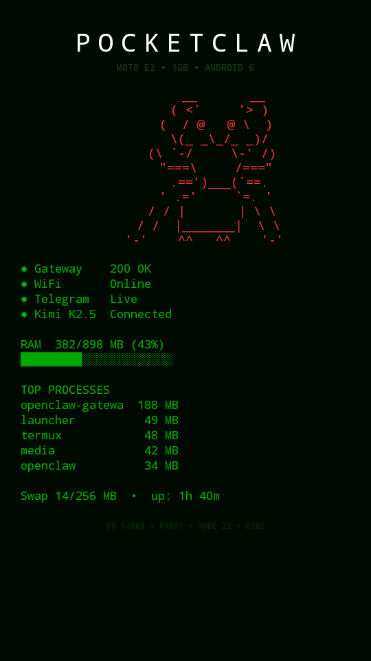
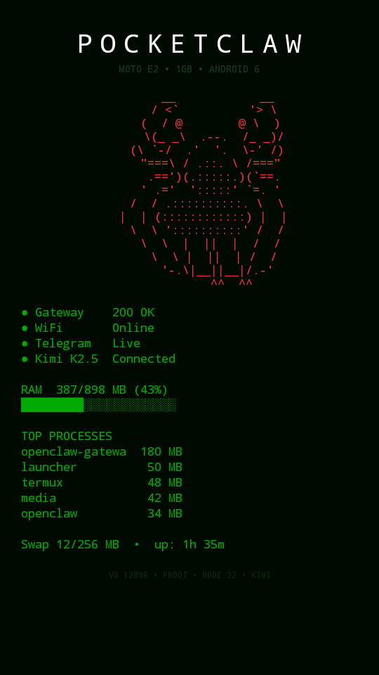

<div align="center">

```
 ██████╗  ██████╗  ██████╗██╗  ██╗███████╗████████╗ ██████╗██╗      █████╗ ██╗    ██╗
 ██╔══██╗██╔═══██╗██╔════╝██║ ██╔╝██╔════╝╚══██╔══╝██╔════╝██║     ██╔══██╗██║    ██║
 ██████╔╝██║   ██║██║     █████╔╝ █████╗     ██║   ██║     ██║     ███████║██║ █╗ ██║
 ██╔═══╝ ██║   ██║██║     ██╔═██╗ ██╔══╝     ██║   ██║     ██║     ██╔══██║██║███╗██║
 ██║     ╚██████╔╝╚██████╗██║  ██╗███████╗   ██║   ╚██████╗███████╗██║  ██║╚███╔███╔╝
 ╚═╝      ╚═════╝  ╚═════╝╚═╝  ╚═╝╚══════╝   ╚═╝    ╚═════╝╚══════╝╚═╝  ╚═╝ ╚══╝╚══╝
```

**The 2026 experiment that ran an AI agent gateway on a $0 phone from 2015.**<br>
**1GB RAM. Android 6. Snapdragon 410. It worked.**

[](LICENSE)
[](#project-status)
[-blue.svg)](#before-you-start)

[pocketclaw.dev](https://pocketclaw.dev) · [Setup Guide](#setup-guide) · [The 57 Hacks](HACKS.md) · [Security](SECURITY.md) · [Troubleshooting](TROUBLESHOOTING.md) · [Changelog](CHANGELOG.md)

</div>

---

> [!IMPORTANT]
> **PocketClaw is now [pocketclaw.dev](https://pocketclaw.dev).**
>
> What started as this phone experiment became an independent publication about self-hosted AI agents (OpenClaw, Hermes Agent, Nanobot, NanoClaw, IronClaw, ZeroClaw, Moltworker). We test what claims to work, write down what does, and recommend the boring choice when boring is right.
>
> - **[Hardware guide](https://pocketclaw.dev/hardware)**: what to run each agent on, per agent.
> - **[CVE tracker](https://pocketclaw.dev/cves)**: known vulnerabilities in self-hosted agents.
> - **[Agents](https://pocketclaw.dev/agents)**: the agents we cover and how they compare.
> - **[Setup blueprint](https://pocketclaw.dev/blueprint)**: a one-time paid setup guide.
>
> This repository stays online as the original phone experiment. It is not where the site lives, and it is not actively developed. If you want to run an agent today, start with the hardware guide, not with a 2015 phone.

---

## Project status

Read this before anything else.

- **What it is:** a working proof of concept. The whole repository was written between February 11 and February 20, 2026, on one Motorola Moto E2 (1 GB RAM, Android 6). There have been no code changes since.
- **Maintenance:** best-effort only. Issues and pull requests are read, but nothing is guaranteed to be fixed. Do not use this for anything you depend on.
- **Tested hardware:** one phone. Other devices are untested unless someone reports them in an issue.
- **OpenClaw version:** the gateway was run with OpenClaw 2026.2.9, then 2026.2.12 (it auto-updated during testing). The runtime patches in `scripts/hijack.js` target those versions. Newer OpenClaw releases are untested, and current ones need Node.js 24 or later, which the Android 6 build below cannot provide.
- **Security:** the pinned OpenClaw versions have published critical security advisories. See [Before you start](#before-you-start) and [SECURITY.md](SECURITY.md).

---

## The Dashboard

The web dashboard at `phone-ip:9000/dashboard` has 4 pages: STATUS (live metrics and an animated crab), LOGS (real-time gateway output with level filters), KEYS (API key management) and CTRL (hardware controls, force GC, gateway restart). It uses a green-on-black CRT look. A small native launcher app (in `apk/`) replaces the Android home screen and draws the same dashboard without a WebView.

<div align="center">


</div>

```
┌──────────────────────────────────────────┐
│         P O C K E T C L A W              │
│          MOTO E2 • 1GB • ANDROID 6       │
│                                          │
│              __       __                 │
│             / <`     `> \                │
│            (  / @   @ \  )               │
│             \(  \_-_/  )/                │
│           (\ `-/     \-` /)             │
│            "==/   _   \=="               │
│             .=') [_] (`=.                │
│            ' .='     `=. '               │
│                                          │
│  ● Gateway    200 OK    gateway  157 MB │
│  ● WiFi       Online    system    72 MB │
│  ● Telegram   Live      launcher  39 MB │
│  ● Kimi K2.5  Connected zygote    32 MB │
│                                          │
│  RAM  310/898 MB (34%)                   │
│  ███████░░░░░░░░░░░░░░                   │
│                                          │
│  Swap 14/256 MB  •  auto-boot ✓         │
│                                          │
│      V8 112MB • NATIVE • NODE 22 • KIMI  │
└──────────────────────────────────────────┘
```

---

## The Pitch (February 2026)

You have an old phone in a drawer. Nobody wants it.

We turned one into a **self-hosted AI assistant** that ran 24/7, answered on Telegram, and restarted itself after reboots.

No cloud server. No root required. Bring your own AI provider.

```
You:     "hey, what's the weather like?"
Bot:     "I'm running on a Moto E2 from 2015 with 1GB of RAM.
          I have no idea what the weather is, but I'm impressed
          I can even answer you right now."
```

## What it does

- **A Telegram bot** running on the phone, powered by the [OpenClaw](https://openclaw.ai) gateway
- **Any OpenAI-compatible AI provider** configured in `openclaw.json` (see [Pick your AI](#pick-your-ai))
- **Voice messages** transcribed with OpenAI Whisper, if you add an OpenAI key
- **Self-restarting**: a watchdog loop, a healthcheck cron and a Termux:Boot script bring the gateway back after crashes and reboots
- **`pocketclaw` CLI**: `start`, `stop`, `restart`, `status`, `logs`, `monitor`
- **RAM tuning** for 1 GB: capped V8 heap, 37 lazy-loaded package prefixes, periodic GC, Termux Dalvik VMs killed after boot
- **4-page dashboard** in any browser on the same network, plus a native launcher APK
- **Aggressive debloat** script for the Moto E2: 144 packages down to 13
- **57 documented hacks** in [HACKS.md](HACKS.md): every problem hit along the way and how it was worked around

## The Hardware

It was built on a deliberately bad case:

| | OpenClaw expects | Moto E2 | Gap |
|---|---|---|---|
| **RAM** | 3 GB | 1 GB | 3x under |
| **Android** | 10+ | 6.0 | 4 versions behind |
| **CPU** | ARM64 | ARM32 | Older architecture |
| **Node.js** | v22 | v12 max (Termux native) | 10 major versions |

A newer phone needs fewer of the hacks, but only the Moto E2 was actually tested.

## Architecture

```
┌─────────────┐         ┌─────────────────┐
│  Telegram    │◄───────►│  Any LLM API    │
│  (you)       │         │  (your choice)  │
└──────┬───────┘         └────────┬────────┘
       │                          │
       └──────────┬───────────────┘
                  │
        ┌─────────▼──────────┐
        │  OpenClaw Gateway  │  ~190 MB PSS
        │  (port 9000)       │  (single process)
        ├────────────────────┤
        │  node22-icu        │  NDK cross-compiled
        │  + LD_PRELOAD shim │  API 23 compat
        ├────────────────────┤
        │  Termux (native)   │  sshd + cron only
        ├────────────────────┤
        │  Android 6         │  ~70 MB PSS
        │  (131 packages     │
        │   debloated)       │
        ├────────────────────┤
        │  PocketClaw APK    │  38 MB PSS
        │  (native launcher) │
        └────────────────────┘

        Total: ~310 MB / 898 MB
```

Connections to Telegram and to the AI provider are **outbound**: no port forwarding, no dynamic DNS. The dashboard on port 9000 is the exception: it listens on the local network (see [Known limits](#known-limits)).

---

## Performance (measured on the Moto E2, February 2026)

These numbers come from `dumpsys meminfo` and the project's own monitor script on the single test phone. They were not re-measured since and will differ on other devices or OpenClaw versions.

### Evolution

| | **v0** Initial | **v2** Debloat | **v4** SystemUI opt | **v6** Single process | **v7** Native node | **v8** Lazy + tuned | **v9** Ultra |
|---|---|---|---|---|---|---|---|
| **Packages** | 144 | 25 | 19 | 13 | 13 | 13 | **13** |
| **Runtime** | proot | proot | proot | proot | native node22-icu | native node22-icu | **native node22-icu** |
| **Gateway RSS** | ~231 MB | ~231 MB | ~234 MB | 186 MB | 157 MB | 155 MB | **~190 MB** |
| **V8 heap** | 384 MB | 384 MB | 384 MB | 160 MB | 112 MB | 112 MB | **170 MB** |
| **Android sys** | ~450 MB | ~314 MB | ~170 MB | ~70 MB | ~70 MB | ~70 MB | **~70 MB** |
| **Total RAM** | ~780 MB | ~630 MB | ~500 MB | ~393 MB | ~310 MB | ~321 MB | **~305 MB** |
| **Swap** | 87 MB | 8 MB | 2 MB | 1 MB | 14 MB | 14 MB | **~14 MB** |
| **Module loading** | - | 9 stubs | 9 stubs | 9 stubs | 12 stubs | 37 lazy proxies | **37 lazy proxies** |
| **Dalvik VMs** | running | running | running | running | running | running | **0 (killed)** |
| **Boot** | manual | manual | manual | full auto | full auto | full auto | **full auto + setsid** |

The V8 heap went back up from 112 MB to 170 MB in v9 because OpenClaw 2026.2.12 needed more memory at startup than 2026.2.9.

### Memory budget (v9)

| Component | PSS | Notes |
|---|---|---|
| OpenClaw gateway | ~190 MB | Native node22-icu, V8 heap 170 MB, lazy loading, LD_PRELOAD API 23 shim, 6h restart |
| Android system (system_server) | 72 MB | 13 packages, SystemUI removed, dormant services killed every 5 min |
| PocketClaw Launcher | 39 MB | Native HOME screen (no WebView), required by Android |
| zygote | 32 MB | Shared fork parent |
| surfaceflinger | 10 MB | Display compositor |
| mediaserver | 7 MB | Respawned by init |
| rild + netd + wpa | 7 MB | Radio, network, WiFi daemons |
| logd + other native | 9 MB | Logging, debuggerd, vold, keystore, etc. |
| Termux Dalviks | 0 MB | Killed after boot via setsid + kill-dalvik cron |
| **Total PSS** | **~310 MB** | Of 898 MB usable |

### What was tuned

| Optimization | Effect observed |
|---|---|
| **Native node22-icu** | NDK cross-compiled Node.js 22.12.0 with small-icu. No proot overhead (about -29 MB PSS) |
| **LD_PRELOAD API 23 shim** | `libapi23compat.so` provides 11 API 24 symbols missing from Android 6.0's bionic |
| `--max-old-space-size=170` | Caps the V8 heap. Startup peaked around 146 MB, then grew about 2 MB/h, so the gateway restarts every 6h |
| `--max-semi-space-size=2` | Smaller young generation: more minor GCs, lower peak RSS |
| `--expose-gc` + periodic GC | `global.gc()` every 30s |
| **setsid + kill-dalvik** | Gateway detached, Termux Dalviks killed after boot (20 to 40 MB freed) |
| Lazy loading v3 (Proxy) | 37 package prefixes loaded on first use |
| Debloat | `pm uninstall -k --user 0` plus `pm disable` via Dirty COW, 144 packages down to 13 |
| Kill SystemUI | The launcher provides navigation buttons instead |
| Dormant killer loop | Boot script force-stops respawning services every 5 min |

### What was tried and ruled out

| Idea | Result |
|---|---|
| V8 heap 96 MB | OOM: live heap peaks at 93 MB during startup |
| `--jitless`, `--lite-mode` | Crash: they disable WebAssembly, which OpenClaw needs |
| `--no-turbofan` | Exit code 9, likely killed by the low-memory killer during slower startup |
| `--single-threaded` | Gateway exits silently at startup |
| `NODE_COMPILE_CACHE` | No cache files written on ARM32 / Node 22 |
| esbuild bundling | Would raise memory: V8 loses lazy parsing on one large file |
| QuickJS, txiki.js, LLRT, Hermes, Bun | Cannot run OpenClaw's npm modules, or no ARM32 build |
| V8 startup snapshot | ESM restore fails (`ERR_VM_DYNAMIC_IMPORT_CALLBACK_MISSING`) |
| `pm install -r /system/priv-app/X.apk` | Loses privileged permissions. Never do this |
| `pm clear com.android.systemui` | Corrupts keyguard, black screen lockout |
| Force-stop `com.termux.boot` | Blocks `BOOT_COMPLETED`, so the bot no longer auto-starts |

The full list, with the reasoning behind each one, is in [HACKS.md](HACKS.md).

---

## Setup Guide

### Before you start

- **Pin OpenClaw.** Install `openclaw@2026.2.12`, the last version this project ran. An unpinned `npm install -g openclaw` now installs a release that requires Node.js 24.16 or later and will not start on the Node 22 runtimes used here.
- **Know what you are running.** OpenClaw 2026.2.x is affected by published critical advisories (the GitHub Advisory Database lists OpenClaw up to 2026.6.6-beta.2 as affected). Run it only on a network you trust, with a dedicated Telegram bot and an AI provider key that has a spending limit. Check [pocketclaw.dev/cves](https://pocketclaw.dev/cves) for the current list.
- **The phone is deliberately weakened.** The Android 6 path uses a kernel exploit (Dirty COW, `tools/dirtycow.c`) on your own device to stop system daemons, and an Android 6 phone no longer gets security updates. Keep it off untrusted networks and do not put personal accounts on it.
- **Set a dashboard token.** Without `POCKETCLAW_TOKEN`, anyone on the same network can use the dashboard API. See [Known limits](#known-limits).

There are two paths. **Path A** (Android 7+) is scripted and uses an Ubuntu container under proot. **Path B** (Android 5 and 6) is the native setup that the Moto E2 actually ran in its final state, and it is manual.

### Prerequisites (both paths)

- An Android phone, a USB cable and WiFi
- ADB on your PC ([Android SDK Platform Tools](https://developer.android.com/tools/releases/platform-tools))
- A Telegram bot token from [@BotFather](https://t.me/BotFather) (`/newbot`, then copy the token)
- An API key from an AI provider (see [Pick your AI](#pick-your-ai))

### Step 0: Enable USB debugging

1. **Settings > About phone**, tap **Build number** 7 times until you see "You are now a developer!"
2. **Settings > Developer options**, turn **USB debugging** on
3. Plug the phone in, accept **"Allow USB debugging?"** and tick **"Always allow from this computer"**
4. On your PC, `adb devices` should list the phone as `device` (not `unauthorized`)

If it shows `unauthorized`, revoke USB debugging authorizations in Developer options and reconnect. If no popup appears, try another cable (some are charge-only).

### Path A: Android 7+ (scripted, proot)

**Option 1, from your PC** (installs Termux and Termux:Boot over ADB, runs the installer inside Termux, applies the 24/7 settings, and offers an optional debloat):

```bash
git clone https://github.com/pocketclaw/pocketclaw.git
cd pocketclaw
bash setup.sh
```

**Option 2, from Termux on the phone** (install Termux from [F-Droid](https://f-droid.org/packages/com.termux/), not Google Play). Read the script before running it:

```bash
curl -fsSLO https://raw.githubusercontent.com/pocketclaw/pocketclaw/main/install.sh
less install.sh
bash install.sh
```

`install.sh` installs `proot-distro`, an Ubuntu container, Node.js 22.12.0 inside it, `openclaw@2026.2.12`, `hijack.js`, the `start-openclaw` / `restart-gw` / `healthcheck` / `pocketclaw` commands, two cron jobs and a Termux:Boot script. It sizes the V8 heap from your RAM (170, 256 or 384 MB).

When it finishes, wait about two minutes and open `http://localhost:9000/setup` on the phone, or `http://<phone-ip>:9000/setup` from another device on the same WiFi, to enter your AI provider and Telegram token. Then add `POCKETCLAW_TOKEN` (see [Known limits](#known-limits)).

### Path B: Android 5 and 6 (native, advanced)

This is how the Moto E2 ran in v9: no proot, a cross-compiled Node.js and an LD_PRELOAD shim. Nothing here is prebuilt; you build the runtime yourself.

**1. Termux.** Install Termux **v0.119.0-beta.3** `apt-android-5` from [GitHub Releases](https://github.com/termux/termux-app/releases/tag/v0.119.0-beta.3), then:

```bash
pkg update -y
pkg install -y openssh nodejs
```

Termux's own Node.js is too old to run OpenClaw. It is only used here for its `npm`.

**2. Build the runtime** on a Linux machine:

- `tools/build-node-icu.sh` cross-compiles Node.js for ARM32 Android with small-icu. It expects the Android NDK r26c in `~/android-ndk-r26c` and a Node.js source tree in `~/node`. The project used Node.js v22.12.0 (`git checkout v22.12.0`).
- `tools/api23_compat.c` is the LD_PRELOAD shim. Compile it as a shared library (`libapi23compat.so`) with the NDK's ARM32 clang. The exact command was not recorded in this repo.

Copy the results to the phone as `$PREFIX/bin/node22-icu` and `$PREFIX/lib/libapi23compat.so`.

**3. Install OpenClaw**, in Termux:

```bash
export LD_PRELOAD=$PREFIX/lib/libapi23compat.so
node22-icu $(which npm) install -g openclaw@2026.2.12
```

**4. Deploy the PocketClaw scripts.** On your PC:

```bash
git clone https://github.com/pocketclaw/pocketclaw.git
cd pocketclaw
adb push scripts/hijack.js scripts/start-openclaw.sh scripts/restart-gw.sh \
  scripts/boot-openclaw.sh scripts/pocketclaw.sh config/openclaw.example.json /sdcard/Download/
```

Then in Termux (the scripts still read their config from the historical proot path, so create it even without proot):

```bash
PREFIX=/data/data/com.termux/files/usr
ROOTFS=$PREFIX/var/lib/proot-distro/installed-rootfs/ubuntu
mkdir -p $ROOTFS/root/.openclaw

cp /sdcard/Download/start-openclaw.sh $PREFIX/bin/start-openclaw
cp /sdcard/Download/restart-gw.sh $PREFIX/bin/restart-gw
cp /sdcard/Download/pocketclaw.sh $PREFIX/bin/pocketclaw
chmod +x $PREFIX/bin/start-openclaw $PREFIX/bin/restart-gw $PREFIX/bin/pocketclaw

cp /sdcard/Download/hijack.js $ROOTFS/root/hijack.js
cp /sdcard/Download/openclaw.example.json $ROOTFS/root/.openclaw/openclaw.json
```

Edit `openclaw.json` for your provider (see [Configuration](#configuration)).

**5. Add your keys.** From your PC, `./tools/setup-keys.sh` asks for each key (including `POCKETCLAW_TOKEN`) and pushes them to `/sdcard/Download/pocketclaw-env`. `start-openclaw` imports that file into `$ROOTFS/root/.openclaw/env` on its next start, sets it to mode 600 and deletes the drop file. You can also pass a filled copy of `config/env.example`: `./tools/setup-keys.sh my-keys.env`.

**6. Launch:**

```bash
restart-gw
```

Wait 30 to 60 seconds, then message your bot on Telegram.

### Auto-start on boot (Path B; Path A does this for you)

Install [Termux:Boot](https://github.com/termux/termux-boot/releases/tag/v0.8.1) and open it once on the phone so it registers:

```bash
curl -L -o termux-boot.apk "https://github.com/termux/termux-boot/releases/download/v0.8.1/termux-boot-app_v0.8.1+github.debug.apk"
adb install termux-boot.apk
```

```bash
# In Termux
mkdir -p ~/.termux/boot
cp /sdcard/Download/boot-openclaw.sh ~/.termux/boot/start-pocketclaw.sh
chmod +x ~/.termux/boot/start-pocketclaw.sh
```

> Never `am force-stop com.termux.boot`: it blocks `BOOT_COMPLETED` and the bot stops auto-starting.

### Keep it running 24/7

```bash
# On your PC, once
adb shell settings put global wifi_sleep_policy 2          # WiFi never sleeps
adb shell dumpsys deviceidle whitelist +com.termux         # Exempt Termux from Doze
adb shell dumpsys deviceidle disable                       # Disable Doze
```

Let the screen sleep normally. `start-openclaw` restarts the gateway 10 seconds after any exit, and the healthcheck cron restarts it if it stops answering.

### Debloat (Moto E2 only, at your own risk)

`restore-debloat.sh` runs from your PC over ADB and removes over a hundred packages, including SystemUI and Google services. **The list was written for one Motorola Moto E2.** On another phone it can remove things you need. Read the script, adapt the list, and save your own package list first (`adb shell pm list packages > my-packages.txt`).

```bash
./restore-debloat.sh
adb reboot
```

`setup.sh` (Path A) offers a much smaller, optional debloat list instead.

---

## Known limits

- **Dashboard authentication is off by default.** The dashboard and its API listen on port 9000 for the whole local network. Unless `POCKETCLAW_TOKEN` is set in the env file, anyone on that network can read status and logs, change API keys, toggle modules, restart the gateway or trigger the debloat. With the token set, the API endpoints that change something require it (header `X-PocketClaw-Token` or `?token=`). The built-in dashboard pages do not send the token yet, so their KEYS and CTRL buttons answer `401` once a token is set; use `tools/setup-keys.sh` and the CLI instead.
- **Read-only endpoints stay open** even with a token: `/api/status`, `/api/history`, `/api/heap`, `/api/logs`, `/api/modules`. Logs can contain message contents.
- **No updates.** The project pins OpenClaw 2026.2.12 and Node.js 22.12.0, both behind on security fixes. Newer OpenClaw needs Node.js 24+, which is out of reach of the Android 6 build.
- **One test device.** Only the Moto E2 was tested end to end. Path A was written for Android 7+ but not validated on a range of phones.
- **Memory leak.** On 1 GB the gateway grew about 2 MB/h and was restarted every 6 hours.
- **Some scripts in `tools/` are experiments** (kernel tuning tests, Dirty COW payloads, proot tests) kept for the record. Only the ones referenced in this guide are part of the setup.

---

## Pick your AI

OpenClaw talks to many providers. You set the provider, model name and API key in `openclaw.json`, with models written as `provider/model-name`. The project was tested with **Kimi K2.5**. Other providers that OpenClaw 2026.2.x supported include Google Gemini, Groq, Cerebras, OpenRouter, Mistral, Anthropic, OpenAI, xAI, DeepSeek, Amazon Bedrock and local servers such as Ollama, LM Studio or vLLM (any OpenAI-compatible `/v1` endpoint).

Free tiers, prices and model names change often. Check the provider's own page before choosing, and set a spending limit on the key you put on the phone.

---

## Configuration

### Critical settings in `openclaw.json`

| Setting | Why it matters |
|---|---|
| `User-Agent: claude-code/1.0` | **Kimi only.** In February 2026 the Kimi coding API rejected requests without a recognized coding agent header. Not needed for other providers. |
| `plugins.entries.telegram.enabled: true` | **Required.** Without it, Telegram does not load even if `channels.telegram` is configured. |
| `reasoning: false` | Avoids extended thinking mode, which produced empty replies. |
| `network.autoSelectFamily: true` | Dual-stack IPv4/IPv6. |
| `maxConcurrency: 1` | One request at a time. More would OOM on 1 GB. |

Node flags (`--max-old-space-size`, `--expose-gc`, `--max-semi-space-size`) are set in `start-openclaw`. See [`config/openclaw.example.json`](config/openclaw.example.json) for the full configuration that ran on the phone, and [`config/env.example`](config/env.example) for the keys.

---

## Troubleshooting

<details>
<summary><b>Bot doesn't respond</b></summary>

1. Check processes: `ps | grep openclaw`
2. Check logs: `tail -20 $PREFIX/tmp/openclaw-gateway.log`
3. Check the bot token with the Telegram `getMe` endpoint from a machine you trust (do not paste the token into logs or issues).
</details>

<details>
<summary><b>"fetch failed" errors</b></summary>

Network issue. Check WiFi. If IPv4 routing is broken, reboot the phone.
</details>

<details>
<summary><b>Gateway won't start, "already running"</b></summary>

Stale lock files. `restart-gw` cleans them, or manually:
```bash
rm -f $ROOTFS/tmp/openclaw/*.lock
```
</details>

<details>
<summary><b>Gateway refuses to start after an OpenClaw update</b></summary>

Check `openclaw --version`. If it is not 2026.2.x, reinstall the pinned version (`openclaw@2026.2.12`). Recent releases require Node.js 24.16+.
</details>

<details>
<summary><b>Out of memory, phone freezes</b></summary>

- Check that `--max-old-space-size` is in `NODE_OPTIONS`
- On the Moto E2, run the debloat
- **Never kill** `com.termux` or `com.termux.boot`
</details>

<details>
<summary><b>Stuck in Settings (no back button)</b></summary>

If SystemUI was removed, there is no navigation bar outside the launcher:
```bash
adb shell input keyevent KEYCODE_BACK
adb shell input keyevent KEYCODE_HOME
```
</details>

<details>
<summary><b>Bot doesn't auto-start after reboot</b></summary>

`com.termux.boot` was probably force-stopped. Open the Termux:Boot app once, or:
```bash
adb shell monkey -p com.termux.boot -c android.intent.category.LAUNCHER 1
```
</details>

More in [TROUBLESHOOTING.md](TROUBLESHOOTING.md).

---

## Project Structure

```
pocketclaw/
├── README.md                  # You are here
├── HACKS.md                   # The 57 hacks, the full story
├── TROUBLESHOOTING.md         # More fixes
├── SECURITY.md                # How to report a vulnerability
├── CHANGELOG.md               # Release notes
├── setup.sh                   # PC-side setup over ADB (Path A)
├── install.sh                 # Termux installer, proot (Path A)
├── install-local.sh           # Offline variant of the installer, Moto E2 era
├── restore-debloat.sh         # Moto E2 debloat over ADB
├── config/
│   ├── openclaw.example.json  # Configuration that ran on the phone
│   └── env.example            # API key template
├── scripts/
│   ├── start-openclaw.sh      # Native gateway launcher with watchdog loop (Path B)
│   ├── restart-gw.sh          # Clean kill + restart
│   ├── boot-openclaw.sh       # Termux:Boot auto-start + crons
│   ├── pocketclaw.sh          # CLI: start/stop/restart/status/logs/monitor
│   ├── healthcheck.sh         # Cron: restart gateway if unresponsive
│   ├── logrotate.sh           # Cron: trim logs
│   ├── wifi-watchdog.sh       # WiFi connectivity watchdog
│   └── hijack.js              # Runtime patches: GC, dashboard, lazy loading, fs path rewriting
├── tools/
│   ├── api23_compat.c         # LD_PRELOAD shim: 11 API 24 symbols for Android 6
│   ├── build-node-icu.sh      # NDK cross-compile of Node.js 22 for ARM32
│   ├── setup-keys.sh          # Push API keys to the phone over ADB
│   ├── kill-dalvik.sh         # Cron: kill Termux Dalviks after gateway detach
│   ├── dirtycow.c             # CVE-2016-5195, used on the owner's own phone
│   ├── windows/               # Optional Windows helpers (daemon stopper on USB connect)
│   └── ...                    # Experiments kept for the record
├── apk/                       # Native launcher (Java, Canvas, no WebView)
└── *.png, *-snapshot-*.txt    # Screenshots and measurements from February 2026
```

---

## The 57 Hacks

Every problem hit along the way and how it was worked around: proot crashes, a Dirty COW kernel exploit, cross-compiling Node.js with the NDK, shimming 11 missing API 24 symbols with LD_PRELOAD, OOM at a 96 MB heap, killing Dalvik VMs after boot.

**[Read the full story](HACKS.md)**

---

## Tested with

| Component | Version |
|---|---|
| Phone | Moto E2 4G LTE (XT1524), 2015 |
| Android | 6.0 Marshmallow |
| RAM | 1 GB (898 MB usable) |
| Termux | v0.119.0-beta.3 (apt-android-5) |
| Node.js | 22.12.0 (NDK cross-compiled with small-icu, native, no proot) |
| OpenClaw | 2026.2.9, then 2026.2.12 |
| AI model | Kimi K2.5 |
| Date | February 2026 |

---

## Contributing and security

Device reports, fixes and documentation corrections are welcome, on a best-effort basis: see [CONTRIBUTING.md](CONTRIBUTING.md). To report a vulnerability in this repository, see [SECURITY.md](SECURITY.md). Vulnerabilities in the agents themselves (OpenClaw and others) belong upstream, and we track them at [pocketclaw.dev/cves](https://pocketclaw.dev/cves).

## License

[MIT](LICENSE).

---

<div align="center">

*A phone from 2015. 1 GB of RAM. Native Node.js. 57 hacks. It worked, in February 2026.*

**[pocketclaw.dev](https://pocketclaw.dev)**

</div>
